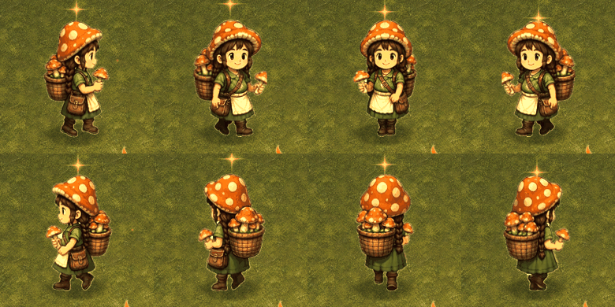
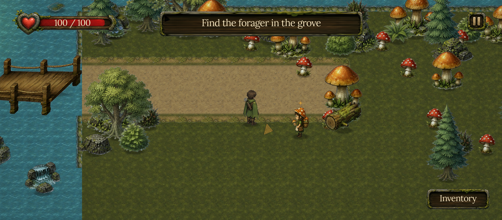

# Idle real y NPC que camina

Medido en Shrine Keeper el 7 de octubre de 2026. Marco pidió completar el idle del player, que podía ser quieto en el lugar, y el idle o walk de la recolectora, usando Chrome y Holopix.

Un clip llamado idle no demuestra descanso. Los ocho idle anteriores eran un frame de caminata con las piernas en pleno paso. Tenían autoplay y un pequeño squash, pero seguían pareciendo detenidos a mitad de caminar. Se generaron ocho vistas neutrales con las botas apoyadas, peso equilibrado y brazos relajados. Un solo frame por dirección cumple el idle estático pedido, con respiración leve y pies anclados. Las imágenes nuevas tienen su propia metadata de facing; no heredan automáticamente los flips de walk.

El NPC anterior era un Sprite2D que se trasladaba por la patrulla. Su cuerpo se movía y sus botas no: parecía deslizarse. Solo ese Visual se convirtió a AnimatedSprite2D dentro de la escena guardada, con idle y un loop de walk. El estado se elige por desplazamiento real, así una colisión o una parada no deja piernas caminando sin avance. El radio de interacción, los colliders y la navegación siguen perteneciendo al cuerpo.

Holopix generó una hoja neutral para el ranger y un video de walk en el lugar para la recolectora. El video salió con fondo negro aunque se pidió blanco. Se inspecciona el crudo antes de elegir el key. El key negro usa conectividad con el borde y conserva regiones negras encerradas, como ojos y sombras del traje. El fringe claro se resuelve con el cleanup de alpha existente. Los originales permanecen intactos.

No centrar cada frame por la bota que toca el piso: alternan izquierda y derecha y eso empuja la cara lateralmente. Se usa una referencia horizontal fija y el mismo anchor de pies en todo el clip. Ranger: canvas 384 por 384, foot 192,376. Recolectora: canvas 320 por 320, foot 160,312 y altura visual 150 px. Son medidas de este caso, no valores universales.

El ciclo de la recolectora conserva ocho frames del video y cierra con una diferencia last-to-first de 0,15 de la mediana entre vecinos. Además de medir el wrap se revisa un preview de frames reales del juego. El probe validó 43 checks, incluyendo las ocho transiciones walk a idle y la parada del NPC cerca del jugador. El replay completo de la quest también pasó. Moverse hacia un NPC que patrulla exige actualizar su posición objetivo mientras se acerca el player. Reiniciar la quest reinicia la patrulla en su home authored.

Memoria: sustituir los idle cargados, sin mantener dos copias visibles ni cargar el video en runtime. Solo se importan PNGs reducidos y SpriteFrames nativos. El juego conservó 60 fps y 148,36 MiB de texturas, por debajo de su límite de 160 MB decimales.

Fuente reproducible: repo `MarcoPaoletta/holopix-shrine-keeper`, commit `f48b4fa`, `docs/ACTOR_ANIMATION_REVIEW.md`, `actor-animation-review.json`, `forager-walk-preview.gif` y `actor-idle-pc.png` en `docs/evidence/`. Los boards de Holopix son 4348 y 4349. Los 305 créditos de esta generación se midieron en la plataforma. No usar el squash de un frame de walk como sustituto de la pose idle que falta.

## Corrección siguiente: ocho direcciones reales

Marco señaló que a la recolectora todavía le faltaban las ocho caminatas. Un walk frontal con flip horizontal no representa perfiles, espalda ni diagonales traseras. La entrega siguiente tiene ocho walk y ocho idle. El controller selecciona el ángulo de la navegación, con histéresis, y cambia a idle por desplazamiento real. Al detenerse mira al visitante. El restart vuelve a su home authored.

La hoja de Holopix no se etiqueta por el prompt. Se inspecciona cada vista. El grid real salió W,SW,S,SW y E,NW,N,NE. La celda repetida SW no es SE. SE comparte el SW auténtico con flip por clip; norte y las diagonales traseras conservan su arte propio. Probar las ocho direcciones con movimiento real y capturar todos los frames antes de llamar completo al personaje.

El preset Walking hizo girar las figuras y cruzar sus celdas. Se rechazó, aunque el video existía y el job había terminado. La acción Custom fijó orientación y posición en todos los frames. Verificar que la opción Custom esté seleccionada: el preset tiene prioridad y descarta la indicación personalizada. La UI mostraba dimensiones mayores, pero ffprobe midió el archivo descargado en 768 por 1024, 24 fps y 124 frames.

La extracción blanca necesita limpiar el color del matte en el borde semitransparente. Solo bajar alpha dejaba una línea clara contra el bosque. Mantener los detalles blancos encerrados del traje y el hongo. No minimizar el wrap hasta cero: una pose final casi duplicada agrega una pausa. En este caso el cierre queda entre 0,992 y 1,051 de un salto normal y cada clip conserva seis frames con timing medido.

El primer canvas de 176 px pasaba por apenas 26 KB el límite de 160 MB decimales. Se redujo a 160 por 160, foot 80,156 y cuerpo de referencia 148 px; la escena mantiene 150 px de altura aparente. El runtime final usa 159,17 MB y 60 fps. El presupuesto se comprueba en el renderer, no solo sumando PNGs. Son medidas del caso, no defaults universales.

La captura de QA espera que termine el fade del speech bubble anterior. De lo contrario el teleport del fixture deja un Talk superpuesto sobre el siguiente personaje, aunque la patrulla ordinaria no tenga ese problema. El editor también necesitó un reimport_files nativo explícito: actualizar la entrada del filesystem reportó éxito pero conservó el CTEX de 176 px. Verificar la dimensión de la textura importada y refrescar solo ese Texture2D, sin recargar profundamente fonts ajenos.

Evidencia de esta revisión: `docs/FORAGER_EIGHT_DIRECTION_REVIEW.md`, `forager-eight-direction-review.json` con 179 checks, `forager8-quest.json`, `forager8-runtime-preview.gif`, `forager8-pc-gameplay.png` y comparación 10 en el repo del juego. Los 275 PNG anteriores conservan sus hashes y los 324 actuales verifican. Los boards 4351 y 4352 consumieron 575 créditos, incluyendo los 270 del intento rechazado. La quest completa vuelve a pasar.

Preview de los seis poses reales por dirección. Fila superior: E,SE,S,SW. Fila inferior: W,NW,N,NE. El GIF usa una cadencia común para comparar poses; cada recurso nativo conserva su timing medido.

Gameplay de PC con ambos personajes y los controles táctiles ocultos:

