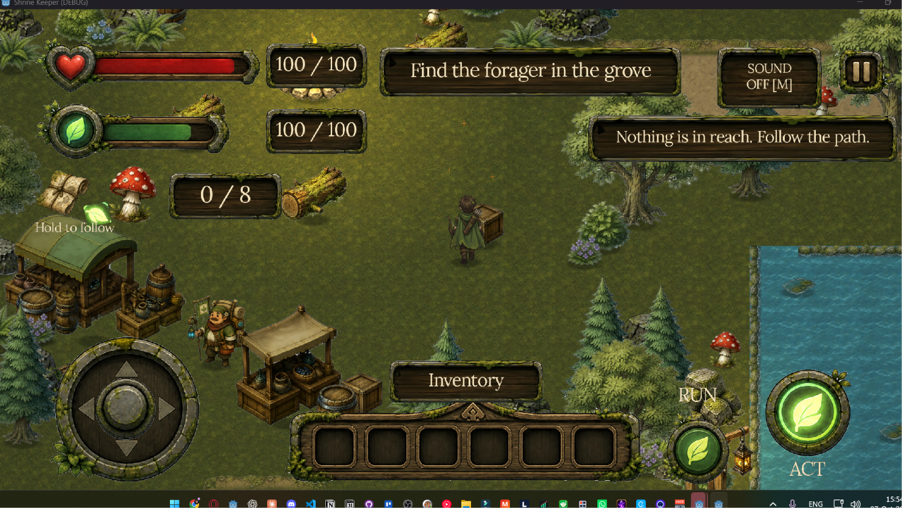
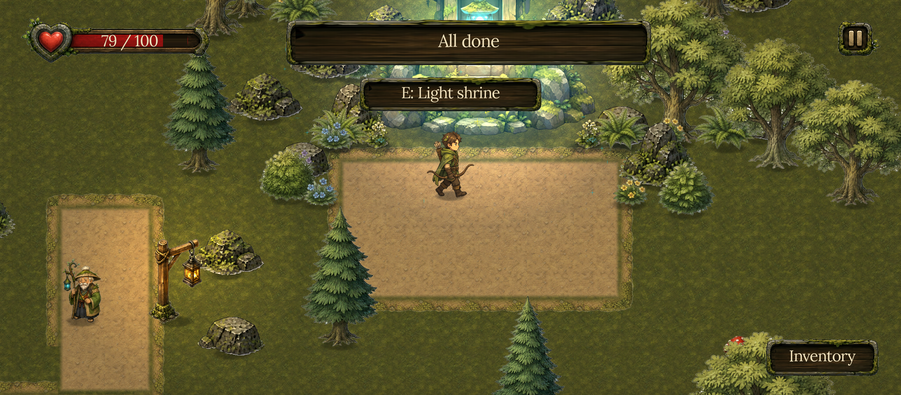
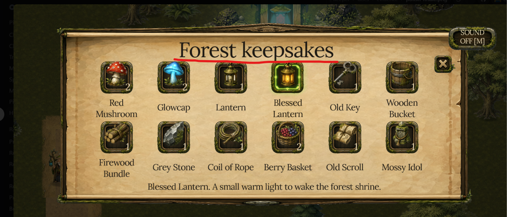
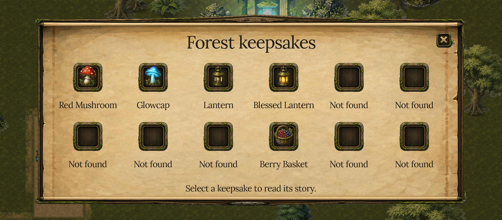
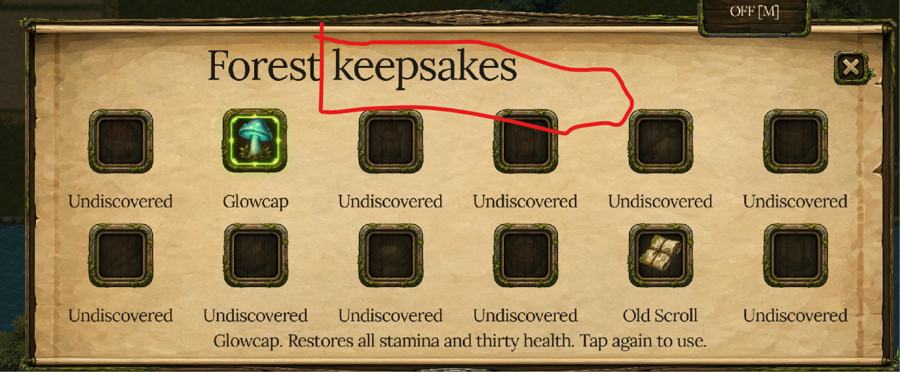
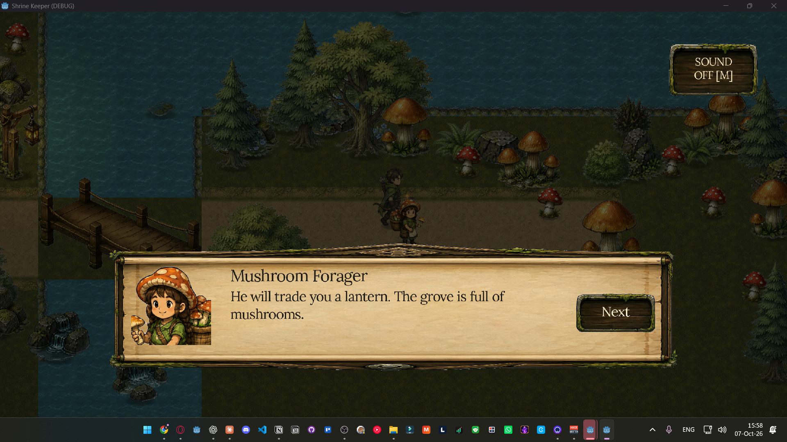
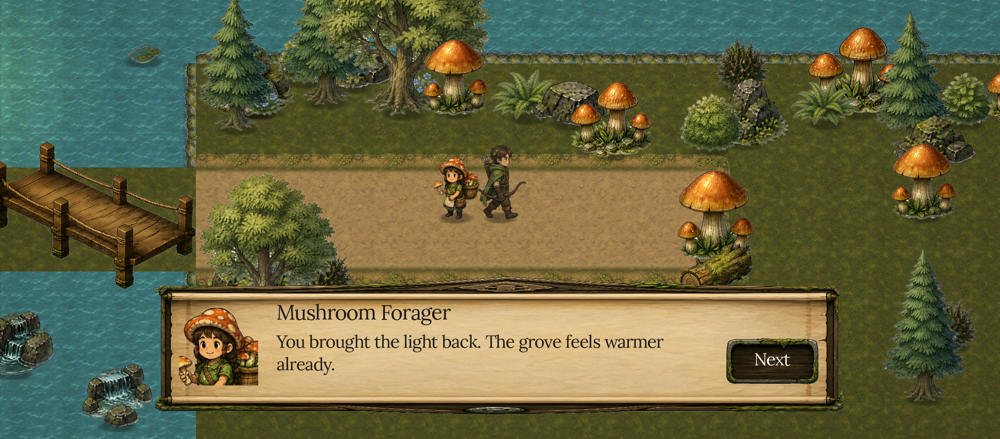

# Shrine Keeper: ejemplos de UI antes y después

Correcciones pedidas por Marco durante el playtest del 7 de octubre de 2026. Leer este ejemplo al revisar padding, jerarquía, densidad del HUD o controles de PC y teléfono. Las imágenes están dentro de la skill y viajan con su espejo, sin depender del repo del juego ni de una carpeta Temp.

Las capturas de antes son las que Marco adjuntó, con sus marcas rojas originales. Las de después son renders reales de la UI corregida. El conteo de items y el avance de la quest pueden diferir. El ejemplo compara estructura y legibilidad, no progresión.

## 1. El HUD de PC no necesita los controles del teléfono

**Pedido:** "way too many UIs. Mobile UI just in mobile" y "The run button as well as interact buttons should not appear on PC ... The joystick should not either".

| Antes | Después en PC |
| :-- | :-- |
|  |  |

Antes, el mundo competía con vida, energía, ratios separados, contador de hongos, scroll, hint de guía, Sound, joystick, Run, ACT, hotbar, inventario y mensaje contextual. Varios bloques duplicaban información o no correspondían al dispositivo.

Después, el HUD persistente de PC queda en vida, objetivo, Pause e Inventory. Shift corre y E o Space interactúa. El prompt aparece cerca del ranger cuando hay algo en alcance. El conteo de hongos forma parte del objetivo. Audio pasa a Pause. El joystick, Run, Interact y la hotbar se reservan al teléfono. Sacar elementos redundantes recupera el mundo sin achicar el texto que el jugador sí necesita leer.

**Corrección técnica:** los controles táctiles se guardan ocultos en la escena, se habilitan por plataforma al arrancar y no se serializa un flag de preview móvil dentro de un arranque de PC. El fixture de F1 es explícito y solo está disponible en debug. El renderer Mobile también puede usarse en PC; su nombre no decide qué interfaz necesita el jugador. En esta captura, el renderer es Mobile, `pc` es true y los seis controles y captions táctiles tienen `visible = false`.

**Criterio para otros juegos:** cada bloque persistente debe responder una necesidad actual del jugador. Preguntar qué decisión permite tomar, si repite otro bloque y si corresponde al método de entrada. El número de elementos de Shrine Keeper es un ejemplo local, no un límite universal. Revisar también la escena sin scripts y el regreso desde pausa, inventario y Continue.

## 2. Padding real dentro del pergamino

**Pedidos:** "needs more padding", "more spacing" y "UI problems + not correctly scaled UI".

| Antes del padding | Después |
| :-- | :-- |
|  |  |

| Otro estado anterior con jerarquía incorrecta | Corrección que debe verse |
| :-- | :-- |
|  | Título centrado respecto del panel, Close con su propio espacio, primera fila separada del título y descripción bajo toda la colección. |

El margen exterior del panel no arregla el padding interior. Hay que medir la superficie plana del pergamino y el espacio ocupado por sus rollos, techo ornamental y bordes. Un título puede estar dentro del Rect2 y todavía tocar visualmente los iconos. Un texto puede entrar en su Label y pisar la siguiente fila.

La corrección usa un panel de 2120 por 940 en el canvas de diseño de 2460 por 1080. El título está centrado, con tamaño 80 y su propia franja. La grilla tiene seis columnas de 320, slots de 180 y filas separadas por 290. Los nombres completos usan tamaño 40 en una línea. La descripción tiene un área de 1800 por 92 bajo la grilla. Los números solo aparecen para cantidades mayores que uno, en su badge propio. Estos valores explican la imagen; se recalculan para otro arte, font o viewport.

Una pasada intermedia permitía dos líneas por nombre pero conservaba una fila demasiado corta: Red Mushroom y Blessed Lantern cruzaban los slots de abajo. La solución final amplió las columnas y mantuvo el nombre en una línea. Se verificaron los doce nombres con el font real y una captura de todos los items. No alcanza con un test de tamaño si el Label se expande automáticamente o el texto invade otro control.

**Criterio para otros juegos:** comprobar el título más ancho, la confirmación más larga, nombres de dos palabras, máximos de cantidad, el último item de una fila y la descripción más larga. Medir contra el contenido real de la ilustración. Conservar tipografía legible y ampliar o reordenar el espacio antes de recurrir a texto chico.

## 3. El diálogo deja ver la escena

**Pedido:** "do not put the black overlay and UI scale problem. Maybe move it down too".

| Antes | Después |
| :-- | :-- |
|  |  |

La corrección elimina el scrim del diálogo, baja el pergamino y separa portrait, speaker, cuerpo y Next. El panel queda en 1700 por 340 con un margen inferior de 60 en el canvas de diseño. El speaker usa 48, el cuerpo 40 y la columna de texto mide 1070 por 165. La línea más larga se verifica completa. Un panel pequeño que recorta texto tampoco es una mejora.

El objetivo es poder leer la conversación y seguir viendo al ranger, al NPC y la zona. El pedido de quitar el overlay corresponde a este diálogo. No se convierte en una prohibición universal de scrims para todos los menús de otros juegos.

## Cómo reutilizar este ejemplo

Hacer una captura limpia de PC con teclado y otra del teléfono o de un fixture móvil claramente identificado. Comparar a escala de gameplay, sobre la zona más cargada. Revisar padding interior, separación entre controles, bordes ornamentales, legibilidad y cuánto mundo queda visible. Una captura con touch activado no se presenta como prueba de la UI de PC.

La validación funcional de Shrine Keeper incluyó entrada real, todos los nombres y descripciones, retorno entre pantallas y seis checks de visibilidad en la escena guardada. La aceptación visual se decide leyendo las imágenes. Los tests por sí solos no declaran buen padding ni una densidad correcta.

Procedencia: repo privado `MarcoPaoletta/holopix-shrine-keeper`. Imágenes copiadas sin dibujar, anotar ni recomponer pixels. El arte del juego sigue siendo Holopix y el font Lora conserva su licencia. Ver también [plataformas, dirección y revisión visual](../platform-and-direction-review.md).
