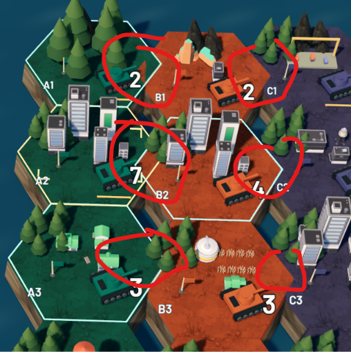

# Z-fighting: prevention and runtime acceptance

Marco's correction, 13 October 2026. Read when authoring 3D tiles, borders, overlays, roads, water, props with base meshes or world-space text. Apply through the project's Godot MCP or native editor tools.

## Reported example

Marco reported z-fighting in the in-progress WorldOS / Modern Day Strategy build and circled multiple regions around terrain, props and large numbers. He had already informed its build session. Preserve this attachment unchanged as a regression reference. It records a reported symptom, not a measured diagnosis of the nodes: one frame cannot prove flicker or identify which meshes share depth. Inspect runtime before assuming every circle has the same cause.

This update changes only the canonical Hub skill and its private mirror. It does not change the game, message its session or refresh existing project copies.

## Prevention in source scenes

1. Give each area one visible base surface. Inspect duplicate instances, overlapping tile tops, ground imported under buildings, water intersecting land and border strips sharing a plane. Adjacent tiles share an edge without covering the same surface area. Fix the owning source scene so repeated instances inherit the correction.
2. Define deliberate layer separation for overlays, along the receiving surface's normal. For a horizontal floor this is height, but it is not always world Y. Test the smallest stable separation at the furthest supported view without making the overlay float. A decal is another option when the target renderer supports it; overlapping decals still need review.
3. Keep text/number planes clear of the ground and each other, including outlines and shadows. Choose occlusion intentionally. Disabling depth testing so labels show through buildings is not a general fix.
4. Store offsets in named authored properties, scenes or resources. Inspect ownership, edit with the project's editor tools, save and reopen, per Rule 1c. Do not replace authored edits with startup scripts that nudge every object.

## Diagnosis and correction

Reproduce in motion. Inspect suspect meshes, world transforms, scales and material modes. Temporarily hide one suspect surface, capture the result and restore visibility. If the artifact disappears, investigate that pair. Distinguish coplanar competition from interpenetration, alpha sorting, shadow artifacts and aliasing before choosing the fix.

Remove duplicate/overlapping faces first; separate intentional overlays second. Then inspect `Camera3D.near` and `far`. Godot documents increasing near and reducing unnecessary far distance for depth precision. Keep all required geometry inside the frustum and test the project's actual engine version/renderer. Camera tuning does not make coincident opaque faces safe. Render priority addresses transparency ordering. Antialiasing and blur do not resolve the underlying depth conflict.

## Runtime acceptance

Inspect every region and repeated instance, not only the first marked tile. Pan at each supported zoom and test camera transitions and nearest/furthest views. A fixed camera still needs review during gameplay and any supported reveal/zoom. Include selection, hover, ownership changes, placement and other states that add overlays.

Inspect a short clip or consecutive frames at target resolution. Required result: zero flicker, alternating surface patches, disappearing border segments or broken world-space text. Overlays remain attached and nearby geometry is not clipped. Save evidence in `docs/evidence/`; record affected node paths, offsets, near/far, renderer, tested views/states and findings in `docs/BUILD_NOTES.md`. Save/reopen the scene and repeat runtime review. Diagnostics and a single still frame are insufficient to close a visual milestone or final build.

## Primary sources checked on 13 October 2026

Depth precision, separation and transparency ordering: [Godot 3D rendering limitations](https://docs.godotengine.org/en/stable/tutorials/3d/3d_rendering_limitations.html).

Clip properties: [Godot Camera3D](https://docs.godotengine.org/en/stable/classes/class_camera3d.html).

Decal support and overlap behavior: [Godot using decals](https://docs.godotengine.org/en/stable/tutorials/3d/using_decals.html).
